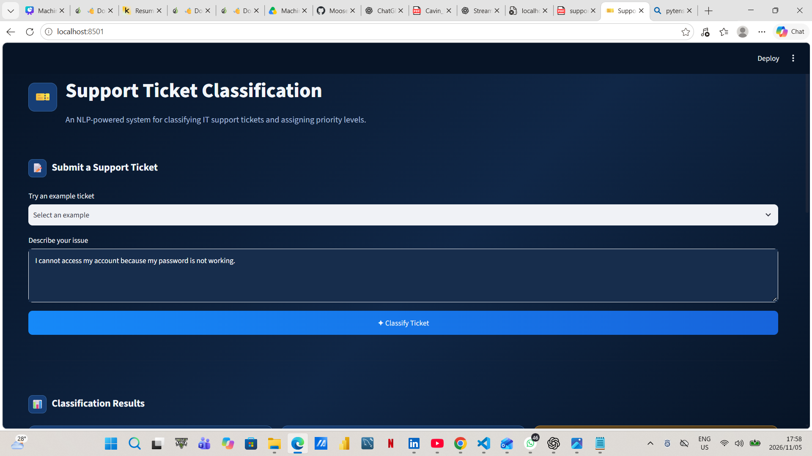
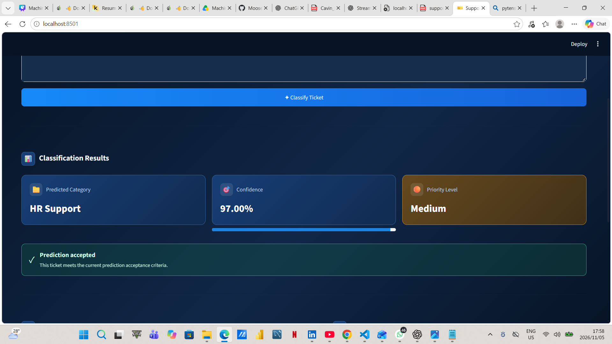
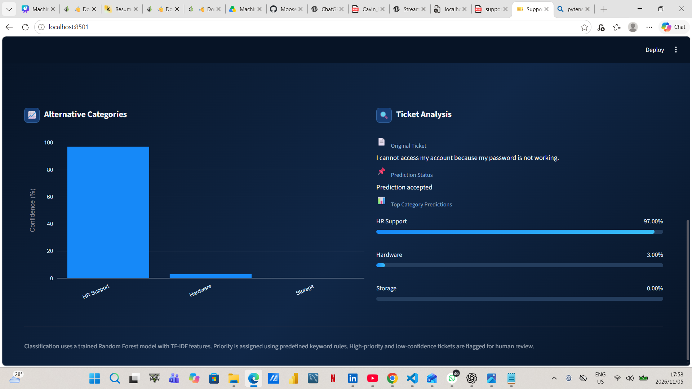

# Support Ticket Classification & Prioritization

## Project Overview

This project uses Natural Language Processing (NLP) and Machine Learning to automatically classify IT support tickets into relevant categories. It also assigns priority levels using a separate rule-based approach to help identify issues that may require urgent attention.

The project includes an interactive Streamlit web application that allows users to submit support tickets, view predicted categories, assess prediction confidence, explore alternative predictions and identify tickets requiring human review.

It demonstrates how machine learning can assist support teams in organising incoming tickets and improving ticket management.

## Live Demo

Access the deployed application here:

[**Support Ticket Classification – Live App**](https://moose-support-ticket-classification.streamlit.app/)

## Objectives

- Clean and preprocess support ticket text.
- Explore ticket patterns and category distributions.
- Convert text into numerical features using TF-IDF.
- Train and compare multiple machine learning classifiers.
- Evaluate model performance using classification metrics.
- Investigate class imbalance and classification errors.
- Assign ticket priority levels using predefined rules.
- Flag uncertain predictions for human review.
- Develop an interactive application for ticket classification.

## Dataset

The project uses `all_tickets_processed_improved_v3.csv`.

**Dataset source:** [IT Service Ticket Classification Dataset – Kaggle](https://www.kaggle.com/datasets/adisongoh/it-service-ticket-classification-dataset)

**Publisher:** adisongoh

The original dataset contains 47,837 support tickets with two main columns:

- `Document`: The support ticket description.
- `Topic_group`: The assigned ticket category.

One record with an empty description after preprocessing was removed, leaving 47,836 records for modelling.

The dataset covers eight categories:

1. Access
2. Administrative rights
3. HR Support
4. Hardware
5. Internal Project
6. Miscellaneous
7. Purchase
8. Storage

## Technologies & Libraries

- Python
- Pandas and NumPy
- Matplotlib and Seaborn
- NLTK
- Scikit-learn
- WordCloud
- Joblib
- Plotly
- Streamlit
- Jupyter Notebook

## Project Workflow

1. Data loading and inspection
2. Exploratory Data Analysis (EDA)
3. Text cleaning and preprocessing
4. TF-IDF feature extraction
5. Training and comparing machine learning models
6. Model evaluation and error analysis
7. Class imbalance investigation
8. Model saving and loading
9. Custom support ticket classification
10. Rule-based priority assignment
11. Streamlit application development and testing

## Machine Learning Models

Four classification algorithms were trained and evaluated using TF-IDF features.

| Model | Accuracy |
|---|---:|
| Logistic Regression | 84.59% |
| Multinomial Naive Bayes | 76.22% |
| Linear SVM | 84.78% |
| Random Forest | 84.97% |

Random Forest achieved the highest accuracy and was selected as the final classification model.

## Model Evaluation

The selected Random Forest model achieved the following results on the test dataset:

- Accuracy: 84.97%
- Weighted Precision: 85.50%
- Weighted Recall: 84.97%
- Weighted F1-score: 84.96%

A confusion matrix and classification report were also used to examine category-level performance and identify misclassified tickets.

A balanced Random Forest model was investigated to evaluate the effect of class weighting on minority categories. The original Random Forest was retained as the final model because it achieved slightly better overall performance.

## Ticket Prioritization

The dataset does not contain priority labels. Therefore, priority assignment is implemented using predefined keyword-based rules rather than supervised machine learning.

Tickets are assigned one of three priority levels:

- **High:** Critical incidents, system failures and security breaches.
- **Medium:** Technical problems, errors and damaged equipment.
- **Low:** General requests and less urgent enquiries.

The system also considers prediction confidence. Predictions with confidence below 70%, as well as all High-priority tickets, are flagged for human review.

## Streamlit Application

The project includes an interactive Streamlit application for classifying support tickets.

Users can:

- Enter a support ticket description.
- Select sample tickets for testing.
- Generate a predicted ticket category.
- View the model's prediction confidence.
- View the assigned priority level.
- Explore alternative category predictions.
- Identify tickets flagged for human review.

The application uses the saved TF-IDF vectorizer and Random Forest model to generate category predictions. Priority assignment and human-review decisions are handled separately using predefined rules.

### Application Preview

**Dashboard Overview**



**Classification Results**



**Ticket Analysis**



### Running the Application Locally

After installing the dependencies, navigate to the project directory containing `app.py` and run:

```bash
streamlit run app.py
```

The application will open in your browser at:

`http://localhost:8501`

## Project Structure

```text
support-ticket-classification/
│
├── data/
│   └── all_tickets_processed_improved_v3.csv
│
├── models/
│   ├── random_forest_model.pkl
│   ├── random_forest_balanced_model.pkl
│   └── tfidf_vectorizer.pkl
│
├── notebooks/
│   └── 01_it_ticket_classification.ipynb
│
├── src/
│
├── app.py
├── predict.py
├── requirements.txt
├── support-ticket-dashboard1.png
├── support-ticket-dashboard2.png
├── support-ticket-dashboard3.png
├── README.md
└── .gitignore
```

## Installation and Usage

### 1. Clone the Repository

```bash
git clone https://github.com/Moose-Pound/FUTURE_ML_02.git
```

### 2. Navigate to the Project Directory

Navigate to the `support-ticket-classification` folder containing `app.py` and `requirements.txt`.

### 3. Create and Activate a Virtual Environment (Optional)

```bash
python -m venv .venv
```

On Windows:

```bash
.venv\Scripts\activate
```

### 4. Install Dependencies

```bash
pip install -r requirements.txt
```

### 5. Run the Streamlit Application

```bash
streamlit run app.py
```

### 6. Explore the Notebook

To explore the analysis, model training and evaluation:

```bash
jupyter notebook
```

Open `notebooks/01_it_ticket_classification.ipynb` and run the notebook cells.

## Limitations

- Some ticket categories contain overlapping language, which can affect classification accuracy.
- The dataset has an imbalanced distribution across categories.
- Priority assignment relies on predefined keywords rather than labelled training data.
- Predictions with low confidence require human verification.
- Keyword-based priority assignment may not capture the full context or business impact of every ticket.

## Conclusion

This project demonstrates the use of NLP and machine learning for automated IT support ticket classification. Random Forest achieved 84.97% accuracy, while a separate rule-based system was developed to assign ticket priorities and flag cases requiring human review.

The Streamlit application provides an interactive interface for testing ticket descriptions and viewing classification results.

The project highlights how machine learning can support ticket management while recognising the importance of human oversight.